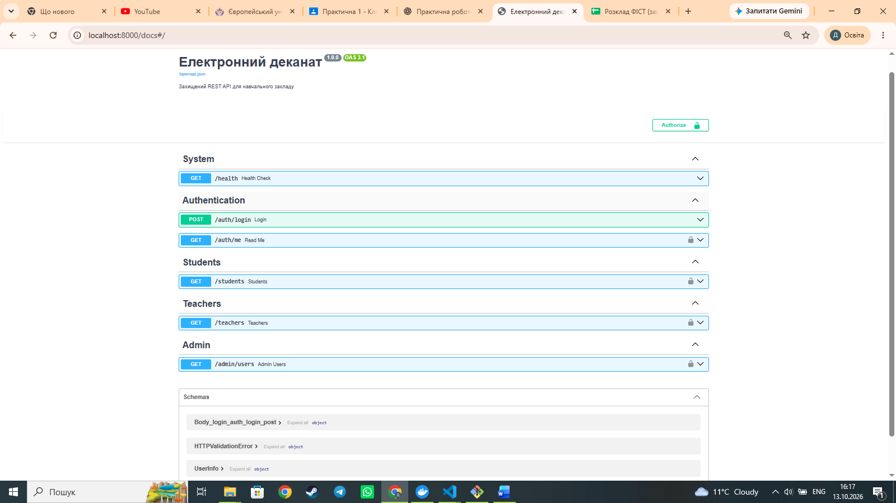
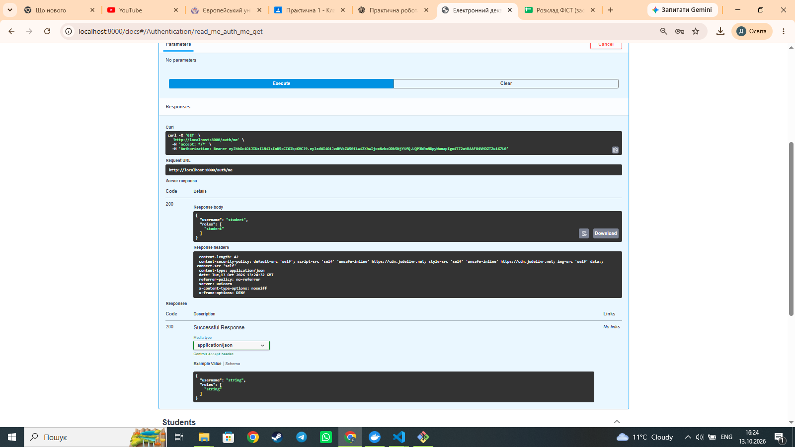
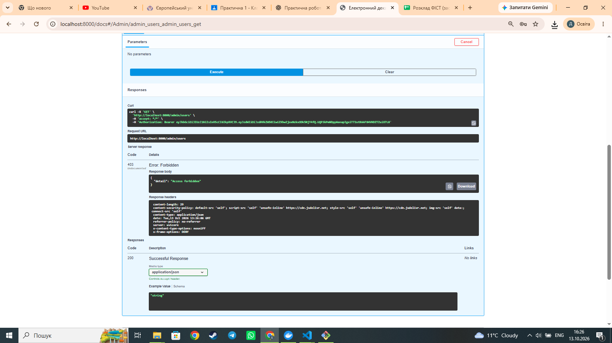
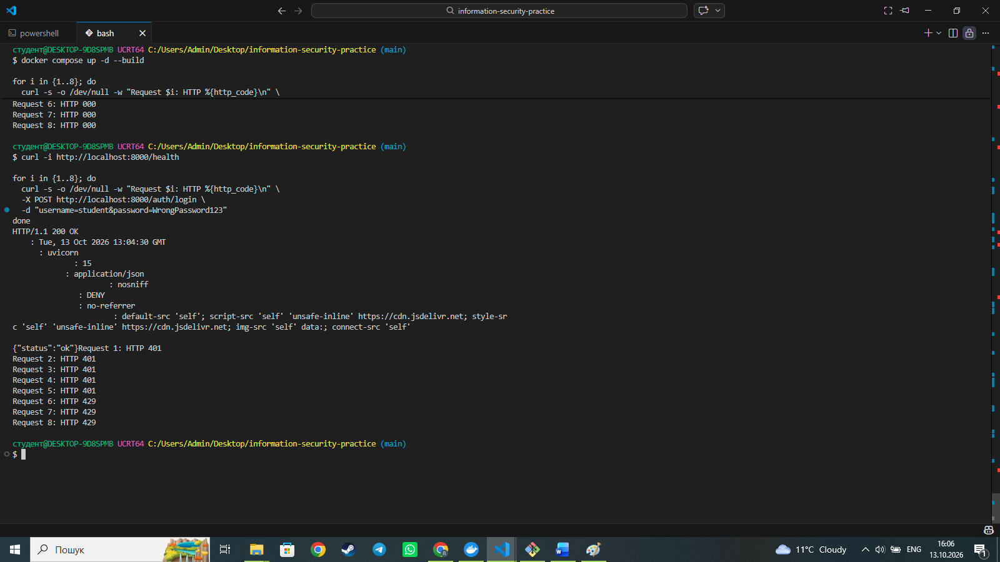
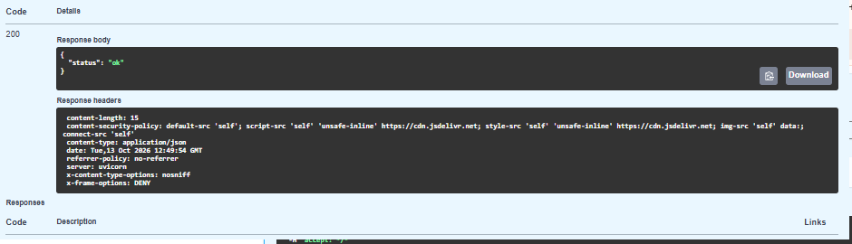

# Захищений REST API «Електронний деканат»

**Практична робота № 1 — Безпека інформаційних систем**  
**Виконав:** Бегулецький Дмитро Миколайович  
**Група:** Б2F501ЗОФ24

## Мета роботи

Розробити REST API навчального закладу із багаторівневим захистом: контейнеризацією Docker, базою даних SQLite, міграціями Alembic, рольовою моделлю доступу (RBAC), хешуванням паролів bcrypt, JWT-автентифікацією, валідацією даних і захистом HTTP-рівня.

## Використані технології

- Python, FastAPI, Pydantic
- SQLAlchemy, SQLite, Alembic
- bcrypt для хешування паролів
- JWT для токенів доступу
- Docker, Docker Compose
- Git, GitHub
- Swagger UI для перевірки API

## Запуск проєкту

Потрібні встановлені Docker Desktop і Git. Після клонування репозиторію:

```bash
git clone https://github.com/behuletskyidmytro-code/information-security-practice.git
cd information-security-practice
cp .env.example .env
```

У файлі `.env` необхідно встановити власний випадково згенерований `SECRET_KEY` (не публікувати його в Git).

```bash
docker compose up -d --build
docker compose exec api alembic upgrade head
docker compose exec api python -m app.seed
```

> **Увага:** замініть `USERNAME` на власне ім'я користувача GitHub. Перед здачею перевірте, що команди міграції та наповнення бази відповідають конфігурації вашого контейнера.

Після запуску:

- Swagger UI: http://localhost:8000/docs
- Перевірка стану API: http://localhost:8000/health

Зупинка:

```bash
docker compose down
```

## Маршрути API

| Метод | Маршрут | Призначення | Доступ |
|---|---|---|---|
| GET | `/health` | Перевірка працездатності | Публічний |
| POST | `/auth/login` | Вхід і отримання JWT | Публічний, обмеження частоти |
| GET | `/auth/me` | Дані поточного користувача | Авторизований користувач |
| GET | `/students` | Розділ студентів | Авторизований користувач |
| GET | `/teachers` | Розділ викладачів | Авторизований користувач |
| GET | `/admin/users` | Перелік користувачів | Лише роль `admin` |

## Ролі та права

Модель даних містить користувачів (`users`), ролі (`roles`), дозволи (`permissions`) і таблиці зв'язків `user_roles` та `role_permissions`. Доступ до адміністративного маршруту перевіряється за роллю `admin`. Користувач із роллю `student` отримує HTTP 403 під час звернення до `/admin/users`.

Тестовий користувач, перевірений під час виконання: **`student`**, роль **`student`**. Тестові облікові записи створюються скриптом `app/seed.py`. Паролі не слід зберігати в README; їхні значення для локального тестування визначаються в seed-скрипті.

## Реалізовані заходи безпеки

1. **Хешування паролів:** у базі зберігаються хеші bcrypt, а не відкриті паролі.
2. **JWT:** після успішного входу клієнт отримує токен і передає його в заголовку `Authorization: Bearer <token>`.
3. **RBAC:** перевірка ролей перед доступом до адміністративних ресурсів.
4. **Валідація:** FastAPI та Pydantic перевіряють параметри й формат запитів.
5. **Rate limiting:** максимум 5 спроб входу за 60 секунд для одного клієнта; подальші спроби отримують HTTP 429.
6. **HTTP-заголовки:** `X-Content-Type-Options`, `X-Frame-Options`, `Referrer-Policy`, `Content-Security-Policy`.
7. **CORS:** визначений перелік дозволених джерел, методів і заголовків.

## Результати тестування

| № | Перевірка | Очікувано | Отримано |
|---|---|---|---|
| 1 | Swagger UI та групи маршрутів | Відображаються System, Authentication, Students, Teachers, Admin | Успішно |
| 2 | Авторизований `GET /auth/me` для `student` | HTTP 200, ім'я й роль | HTTP 200 |
| 3 | `student` звертається до `GET /admin/users` | HTTP 403 | HTTP 403 |
| 4 | Понад 5 спроб входу за хвилину | HTTP 429 | HTTP 429 |
| 5 | `GET /health` і захисні заголовки | HTTP 200, заголовки безпеки | HTTP 200, заголовки наявні |

## Скріншоти виконання

### 1. Документація API


### 2. Успішна авторизація


### 3. Заборона доступу за RBAC


### 4. Обмеження частоти входу


### 5. Захисні HTTP-заголовки


## Аналіз загроз STRIDE

| Категорія | Можлива загроза | Захист у проєкті |
|---|---|---|
| S — Spoofing | Вхід від імені іншого користувача | Перевірка пароля, JWT |
| T — Tampering | Підміна даних запиту або токена | Валідація даних, перевірка підпису JWT |
| R — Repudiation | Заперечення виконаних дій | Журнали HTTP-запитів контейнера; для повного аудиту потрібен окремий журнал дій |
| I — Information Disclosure | Отримання чужих або адміністративних даних | RBAC, перевірка JWT, обмеження CORS |
| D — Denial of Service | Масові спроби входу | Rate limiting для `/auth/login` |
| E — Elevation of Privilege | Студент отримує права адміністратора | Перевірка ролі `admin`, відповідь 403 |

## Висновок

Створено та перевірено REST API «Електронний деканат» з багаторівневим захистом. Перевірки підтвердили працездатність JWT-авторизації, обмеження доступу за ролями, захисних HTTP-заголовків і обмеження частоти спроб входу. Для промислового використання потрібні додаткові заходи, зокрема HTTPS, централізовані журнали аудиту, постійне сховище для rate limiting та суворіша політика CSP.
